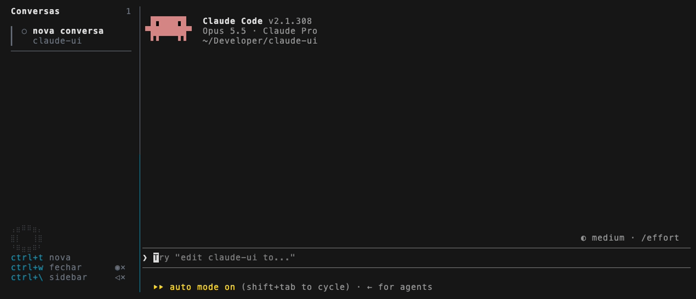

# claude-ui

Interface para o [Claude Code](https://claude.com/claude-code) no terminal: o `claude` ocupa a maior parte da tela e, ao lado, uma barra lateral lista as conversas abertas na sessão, com o status de cada uma. O visual e várias funções do sidebar se inspiram no [workmux](https://github.com/raine/workmux).


- Digitar `claude` no terminal já abre a interface.
- Cada conversa é um `claude` real rodando em segundo plano; escolher uma no sidebar a traz para a área principal sem perder o estado das outras.
- Nada das conversas é salvo: ao fechar o terminal, elas somem do sidebar.
- `command claude` continua abrindo o Claude Code puro, sem a interface.

## Sumário

- [Instalação](#instalação)
- [Modelos de voz e ditado](#modelos-de-voz-e-ditado)
- [Primeiro uso](#primeiro-uso)
- [Funcionalidades](#funcionalidades)
- [Atalhos](#atalhos)
- [Claude Code puro](#claude-code-puro)
- [Problemas comuns](#problemas-comuns)
- [Desinstalar](#desinstalar)
- [Como funciona](#como-funciona)

## Instalação

### 1. Requisitos

- macOS ou Linux, com zsh ou bash
- [tmux](https://github.com/tmux/tmux) 3.x
- [Node](https://nodejs.org) 20+
- [Claude Code](https://claude.com/claude-code) instalado e logado
- Opcional, só para o [ditado por voz](#ditado-por-voz): um gravador de áudio. No macOS, o [ffmpeg](https://ffmpeg.org) (ou o `sox`); no Linux, o `parec` (pulseaudio-utils), o `pw-record` (pipewire) ou o `arecord` (alsa-utils).

Confira se estão no PATH:

```sh
tmux -V           # tmux 3.x
node -v           # v20 ou maior
claude --version  # Claude Code
ffmpeg -version   # opcional, para o ditado
```

No macOS, o que faltar sai pelo Homebrew: `brew install tmux node ffmpeg`.

### 2. Clone e dependências

```sh
git clone https://github.com/ghts2110/claude-ui.git ~/claude-ui
cd ~/claude-ui && npm install
```

O `npm install` também traz o [sherpa-onnx](https://github.com/k2-fsa/sherpa-onnx), que roda a voz da leitura em voz alta e o reconhecimento do ditado no próprio computador. Os modelos em si só são baixados quando você liga cada função (ver [Modelos de voz e ditado](#modelos-de-voz-e-ditado)).

### 3. Função no shell

Adicione ao `~/.zshrc` (ou `~/.bashrc`), ajustando o caminho se clonou em outro lugar:

```sh
claude() { ~/claude-ui/bin/claude-ui "$@"; }
```

Abra um terminal novo (ou rode `source ~/.zshrc`) e digite `claude`.

### 4. Permissões e ajustes do macOS

Nada disso é necessário para usar o sidebar; só para o ditado e o aviso sonoro.

- **Microfone (ditado por voz):** na primeira vez que o ditado é ligado, o macOS pergunta se o Terminal pode usar o microfone; aceite. Se negou antes, libere o Terminal em Ajustes do Sistema > Privacidade e Segurança > Microfone e reabra o Terminal.
- **Som e Dock (aviso quando uma conversa termina):** o aviso é o sino do terminal, não uma notificação do sistema, então não há permissão de notificações a dar. No Terminal.app, em Ajustes > Perfis > Avançado, seção Sino, deixe marcados "Sino audível" e "Fazer ícone do app pular quando em 2º plano" no perfil que você usa. Sem som com a opção marcada, confira o volume de alertas em Ajustes do Sistema > Som.
- **Voz do sistema (opcional):** a leitura em voz alta usa uma voz própria; a do sistema só entra enquanto ela baixa ou se o download falhar. Para tê-la, instale uma voz em português do Brasil em Ajustes do Sistema > Acessibilidade > Conteúdo Falado > Voz do Sistema > Gerenciar Vozes.

## Modelos de voz e ditado

A leitura em voz alta e o ditado rodam no próprio computador: funcionam offline e não gastam tokens. Para isso, cada um baixa um modelo na primeira vez que é ligado, nunca antes. O sidebar mostra o download no rodapé ("baixando voz natural…", "baixando ditado 42%") e a conversa continua usável enquanto isso.

| Função | Modelo | Baixado quando | Download | Em disco |
| --- | --- | --- | --- | --- |
| Leitura em voz alta | [Piper pt_BR faber](https://huggingface.co/rhasspy/piper-voices/tree/main/pt/pt_BR/faber/medium) | a leitura é ligada pela primeira vez | ~67 MB | ~80 MB |
| Ditado por voz | [Whisper turbo](https://github.com/openai/whisper) e detector de fala Silero | o microfone é ligado pela primeira vez | ~540 MB | ~1 GB |

Os dois ficam em `~/.cache/claude-ui` (ou `$XDG_CACHE_HOME/claude-ui`), uma pasta por modelo. É a única coisa que o claude-ui grava fora do repositório. Apagar a pasta remove os modelos; eles são baixados de novo na próxima vez que a função for ligada. Um download interrompido (terminal fechado no meio) não deixa um modelo pela metade: recomeça do zero na próxima vez.

No Linux, extrair os modelos precisa do `bzip2`. Os modelos rodam em macOS e Linux, Intel e ARM; em outra plataforma, a leitura usa a voz do sistema e o ditado fica indisponível.

## Primeiro uso

`claude` abre a interface com uma conversa. Argumentos são repassados ao Claude Code (`claude --continue`, `claude "corrige o teste"`) e valem só para essa primeira conversa.


- **Criar:** `Ctrl-T`, de qualquer lugar, abre uma conversa nova e a traz para a tela.
- **Alternar:** `Ctrl-\` leva o foco ao sidebar; escolha com `↑`/`↓` e `Enter` (ou clique). As que não estão na tela continuam rodando.
- **Fechar:** `Ctrl-W` fecha a conversa da tela (confirma com `s`) e põe a vizinha no lugar; na última, abre uma nova. `/exit` também fecha a conversa e, na última, encerra a interface.
- **Ditar e ouvir:** `Ctrl-Q` liga o microfone; o alto-falante no rodapé do sidebar liga a leitura em voz alta.
- **Ajuda:** com o sidebar focado, `?` lista os atalhos.

Fechar o terminal encerra tudo: as conversas, o sidebar e o tmux por trás deles.

## Funcionalidades

### Status de cada conversa


A faixa e o ícone à esquerda mostram o status: `✓` verde quando o Claude terminou, `?` azul quando precisa de você (pergunta, permissão ou aprovação), spinner amarelo enquanto trabalha e `○` antes da primeira mensagem. Ao lado, há quanto tempo está nesse status. `Esc` ou `Ctrl-C` no meio de uma resposta passam a conversa para pronta.

### Título, pasta e linhas mudadas

O título é o assunto que o Claude Code dá à conversa (o mesmo do título do terminal); antes disso, a primeira mensagem, e até lá "nova conversa". `/clear` volta ao provisório.

Embaixo, a pasta da conversa e as linhas que o Claude adicionou e removeu nela com as ferramentas de edição (`+12 -3`), contadas por conversa: duas conversas no mesmo repositório mostram cada uma as suas, e uma que não editou nada não mostra contador. É o acumulado das edições, não o saldo contra o último commit: editar a mesma linha duas vezes conta duas, e mudanças feitas por comandos no terminal ficam de fora. `/clear` zera o contador.

### Novidades fora da tela

Conversa que termina ou passa a esperar por você fora da tela fica em negrito até ser aberta. O topo do sidebar conta quantas esperam (`?1`), quantas terminaram sem ser vistas (`✓2`) e o total. `p` pula para a próxima pendente.

### Aviso com som e no Dock

Quando qualquer conversa termina a resposta ou passa a esperar por você, o terminal recebe um sino: o Mac apita e, se o Terminal estiver em segundo plano, o ícone dele pula no Dock. Vale também para as conversas fora da tela. Só a mudança avisa: uma conversa que continua pronta ou esperando não apita de novo, e interromper com `Esc` ou `Ctrl-C` não apita. O ajuste do Terminal.app para isso está em [Permissões e ajustes do macOS](#4-permissões-e-ajustes-do-macos).

### Troca sem perder estado


Trocar de conversa só muda qual `claude` ocupa a área principal: nenhum processo é reiniciado, e uma pergunta pendente continua lá quando você volta. `Tab` volta para a conversa anterior e `1`-`9` abrem a conversa daquela posição.

### Cabeçalho fixo

Quando o logo do Claude Code (versão, modelo, plano e pasta) rola para fora da conversa, uma cópia dele fica fixa acima dela; se o logo voltar à tela, a cópia sai. Se ele sumir do histórico, aparecem só versão, plano e pasta.

### Uso do plano

No rodapé do sidebar, um anel enche em laranja conforme a janela de 5h do plano Pro/Max é consumida. Com o mouse em cima, ou depois de um clique nele, aparecem a % usada e a hora em que a janela reinicia. O dado vem da statusline do Claude Code, então só muda quando alguma conversa do claude-ui recebe resposta; antes disso, ou com login por API, o anel fica apagado. Se você tem uma statusline própria, ela continua aparecendo.

### Leitura em voz alta

O alto-falante no canto de baixo do sidebar (ou `v`, com o sidebar focado) liga a leitura: cada texto que o Claude escreve na conversa da tela é falado assim que ele termina aquele trecho, sempre o mais recente; o que já estava escrito antes de ligar não é lido. Blocos de código, diffs, tabelas, links e saídas de comando ficam de fora. Um texto novo, uma mensagem sua, `Esc` ou `Ctrl-C` calam a fala; as conversas em segundo plano ficam em silêncio. Começa desligada.

A voz é a Piper pt_BR faber, gerada no próprio computador pelo sherpa-onnx e começa a falar meio segundo depois do texto. Na primeira vez, ela é baixada (ver [Modelos de voz e ditado](#modelos-de-voz-e-ditado)). Enquanto baixa, ou se o download falhar, a leitura usa a voz pt-br do sistema (`say` no macOS, `espeak-ng` no Linux) e tenta baixar de novo na próxima vez que for ligada. Sem nenhuma das duas, o sidebar mostra como instalar a do sistema.

### Ditado por voz



O microfone no rodapé do sidebar, logo acima do alto-falante (ou `Ctrl-Q` de qualquer lugar, ou `m` com o sidebar focado), liga o ditado: o que você fala vai sendo digitado no campo de mensagem da conversa da tela, uma frase de cada vez, a cada pausa. Nada é enviado sozinho: revise, corrija se precisar e aperte `Enter`.

- **Parar:** clicar de novo, `Ctrl-Q` ou `m` param de ouvir (o que já foi dito ainda é digitado). Enviar a mensagem e 20 segundos sem fala também param.
- **Escolhas:** se a conversa está esperando uma escolha sua (permissão, pergunta), o que você ditar espera ela voltar ao campo de mensagem, para nenhuma palavra escolher uma opção.
- **Enquanto ouve:** o ícone fica vermelho, as ondas pulsam com a sua voz e a leitura em voz alta fica muda, para o ditado não transcrever a voz do Claude.

O reconhecimento é o Whisper turbo, o reconhecimento de voz aberto da OpenAI, rodando no próprio computador pelo sherpa-onnx: entende termos em inglês no meio do português ("abre um pull request"). Na primeira vez, o modelo é baixado, com o progresso no rodapé (ver [Modelos de voz e ditado](#modelos-de-voz-e-ditado)). Ouvir o microfone precisa de um gravador (ver [Requisitos](#1-requisitos)) e, no macOS, do [acesso do Terminal ao microfone](#4-permissões-e-ajustes-do-macos); faltando algum, o sidebar diz o que fazer.

### Sidebar ajustável

`h` esconde o sidebar e a conversa ocupa o terminal inteiro; `Ctrl-\` o traz de volta. `<` e `>` estreitam e alargam o sidebar, e arrastar a borda com o mouse também vale. A largura se mantém ao redimensionar o terminal, até metade dele. A borda do pane com o foco fica em ciano, então dá para ver se as teclas vão para o sidebar ou para a conversa.

### Mac acordado

No macOS, enquanto a interface estiver aberta, o Mac não entra em repouso e a tela não apaga por inatividade, então dá para acompanhar uma tarefa longa sem ela parar no meio. Fechar a tampa continua pondo o Mac para dormir. Quando a sessão acaba, inclusive com o terminal fechado ou num crash, tela e repouso voltam ao comportamento normal (é o `caffeinate` do sistema, preso ao processo do tmux).

## Atalhos


| Tecla | Onde | Ação |
| --- | --- | --- |
| `Ctrl-\` | qualquer lugar | alterna o foco entre o sidebar e a conversa; com o sidebar escondido, o traz de volta |
| `Ctrl-T` | qualquer lugar | conversa nova |
| `Ctrl-W` | qualquer lugar | fecha a conversa da tela (confirma com `s`) |
| `Ctrl-Q` | qualquer lugar | liga / desliga o ditado por voz |
| `Esc`, `Ctrl-C` | qualquer lugar | calam a fala em andamento (e chegam ao Claude Code como sempre) |
| `↑`/`↓`, `j`/`k` | sidebar | escolhe a conversa |
| `g`/`G` | sidebar | vai ao início e ao fim |
| `Enter`, clique | sidebar | traz a conversa para a tela (a rodinha do mouse move a seleção) |
| `1`-`9` | sidebar | abre a conversa daquela posição |
| `Tab` | sidebar | volta para a conversa anterior |
| `p` | sidebar | próxima pendente: a que passou a esperar por você ou terminou sem ser vista, depois as que continuam esperando |
| `n` / `x` | sidebar | conversa nova / fecha a selecionada (pede confirmação) |
| `h` | sidebar | esconde o sidebar |
| `<` / `>` | sidebar | estreita / alarga o sidebar (ou arraste a borda) |
| `v`, clique no alto-falante | sidebar | liga / desliga a leitura em voz alta |
| `m`, clique no microfone | sidebar | liga / desliga o ditado por voz |
| clique no anel | sidebar | mostra a % usada do plano e quando a janela reinicia |
| `?` | sidebar | mostra os atalhos (`?`, `q` ou `Esc` fecham) |
| `Esc` | sidebar | volta para a conversa |

Fora `Ctrl-\`, `Ctrl-T`, `Ctrl-W` e `Ctrl-Q`, os atalhos só valem com o sidebar focado, então os do Claude Code continuam chegando a ele. Esses quatro deixam de chegar ao Claude Code dentro da interface (o `Ctrl-W` não apaga mais a palavra anterior no prompt). O prefixo do tmux fica desligado (`Ctrl-b` chega ao Claude Code) e `Ctrl-Z` fica desativado: suspenderia o claude sem um shell para trazê-lo de volta.

## Claude Code puro

A interface sempre deixa uma saída para o Claude Code sem nada em volta:

- `command claude` abre o Claude Code puro, sem a interface.
- Rodar `claude` dentro da interface (ou de qualquer tmux) também abre o Claude Code puro.
- Modos não interativos e subcomandos (`-p`, `--version`, `--help`, `mcp`, `update`, `doctor`, ...) e uso em pipes ou scripts rodam o Claude Code puro, para a saída não sumir com o tmux.

## Problemas comuns

### Ao abrir

| Mensagem | Causa e solução |
| --- | --- |
| `claude-ui: tmux não encontrado. Instale com 'brew install tmux'` | tmux ausente ou fora do PATH. Instale (`brew install tmux`, `apt install tmux`) e abra um terminal novo. |
| `claude-ui: Node não encontrado. Instale o Node 20+` | Node ausente ou fora do PATH. Confira `command -v node` num terminal novo; com nvm carregado sob demanda (lazy load), carregue-o no início do shell ou rode `nvm alias default 20`. |
| `claude-ui: dependências faltando. Rode 'npm install' em ...` | Faltou o passo 2: rode `npm install` na pasta clonada. |
| `claude-ui: Claude Code não encontrado no PATH.` | O binário `claude` não está no PATH. Instale o Claude Code e confira com `command -v claude`. |
| `no such file or directory: .../bin/claude-ui` (zsh) ou `.../bin/claude-ui: No such file or directory` (bash) | O caminho na função do `~/.zshrc` (ou `~/.bashrc`) não aponta para onde o repositório foi clonado. |

### No sidebar

| Sintoma | Causa e solução |
| --- | --- |
| Conversa sem título e sem status | Título e status vêm de hooks do Claude Code passados com `--settings` (ver `sidebar/hooks.json`). Passar outro `--settings` ou desligar hooks nas suas configurações os desativa. |
| Anel do uso do plano sempre apagado | Ele só acende depois que uma conversa do claude-ui recebe resposta, e não aparece com login por API. |
| Nenhum som quando uma conversa termina | Confira o sino do perfil do Terminal.app e o volume de alertas (ver [Permissões e ajustes do macOS](#4-permissões-e-ajustes-do-macos)). |
| "sem voz natural: usando a do sistema" | O download da voz falhou (sem internet, sem `bzip2` no Linux). A leitura segue com a voz do sistema e tenta baixar de novo na próxima vez que for ligada. |
| "Sem voz em português do Brasil." | Sem a voz natural e sem voz pt-br no sistema. Instale uma em Ajustes do Sistema > Acessibilidade > Conteúdo Falado > Voz do Sistema > Gerenciar Vozes (Linux: `sudo apt install espeak-ng`). |
| "Sem gravador de áudio." | Instale o `ffmpeg` (`brew install ffmpeg`); no Linux, `pulseaudio-utils`, `pipewire` ou `alsa-utils`. Depois clique no microfone de novo. |
| "Sem acesso ao microfone." | Libere o Terminal em Ajustes do Sistema > Privacidade e Segurança > Microfone e reabra o Terminal. Se já está liberado, confira o volume de entrada em Ajustes do Sistema > Som > Entrada. |
| "sem ditado: o download falhou" | Sem internet ou sem `bzip2` no Linux. Clique no microfone para tentar de novo. |
| "silêncio longo: parei de ouvir" | 20 segundos sem fala desligam o microfone. Ligue de novo quando for falar. |

Enquanto não resolve, `command claude` abre o Claude Code puro.

## Desinstalar

1. Apague a linha `claude() { ... }` do `~/.zshrc` (ou `~/.bashrc`) e abra um terminal novo.
2. Apague a pasta clonada: `rm -rf ~/claude-ui`.
3. Apague os modelos da leitura em voz alta e do ditado, se foram baixados: `rm -rf ~/.cache/claude-ui`.
4. Opcional: tire o acesso do Terminal ao microfone em Ajustes do Sistema > Privacidade e Segurança > Microfone, se só o liberou para o ditado.

Não sobra mais nada: fora esses modelos, o projeto não salva arquivos fora do repositório e cada sessão do tmux morre com o terminal.

## Como funciona

- **tmux** cuida do layout e mantém cada conversa viva em seu próprio pane; trocar de conversa troca qual pane ocupa a área principal. Cada terminal tem seu próprio servidor tmux, com a config do repo (`tmux.conf`); o `~/.tmux.conf` não é lido.
- **Node + [Ink](https://github.com/vadimdemedes/ink)** desenha o sidebar, que conversa com o tmux pela linha de comando.
- **Hooks e statusline do Claude Code** avisam o sidebar quando uma conversa muda de status, ganha título ou edita arquivos, e trazem o uso do plano.
- **[sherpa-onnx](https://github.com/k2-fsa/sherpa-onnx)** roda a voz da leitura e o reconhecimento do ditado localmente.
- Uma função no `~/.zshrc` (ou `~/.bashrc`) troca o `claude` pelo launcher do projeto, que chama o binário original com `command claude`.

Testes do launcher: `npm test`.

## Licença

[MIT](LICENSE)
