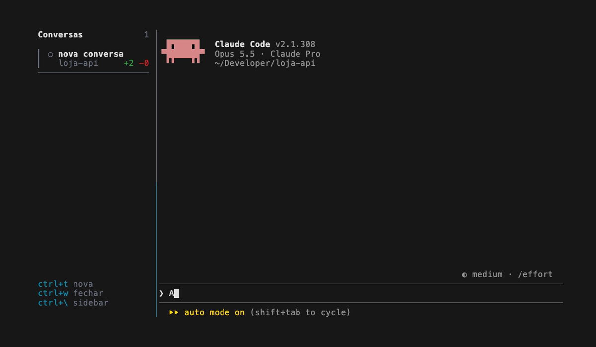
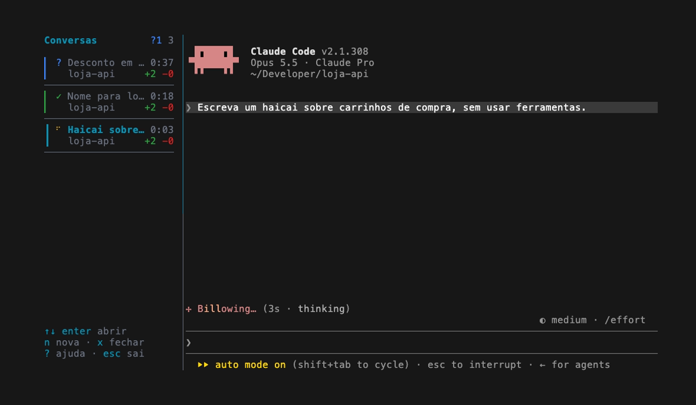
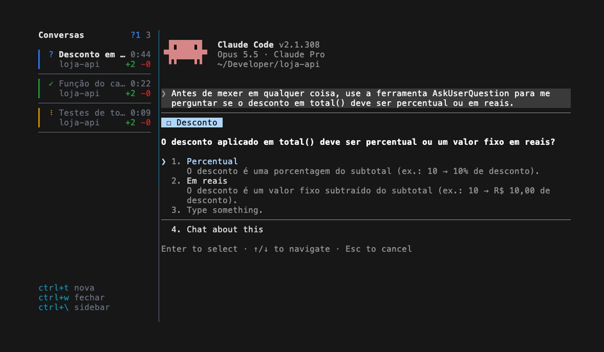
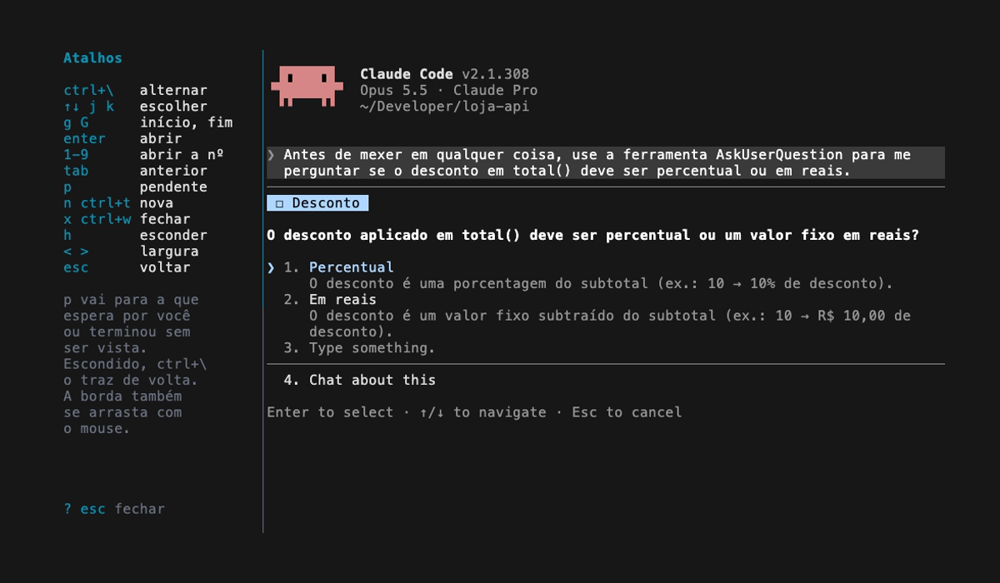

# claude-ui

Interface para o [Claude Code](https://claude.com/claude-code) no terminal: o `claude` ocupa a maior parte da tela e, ao lado, uma barra lateral lista as conversas abertas na sessão. O visual e várias funções do sidebar se inspiram no [workmux](https://github.com/raine/workmux).


## Ideia

- Digitar `claude` no terminal já abre a interface.
- Cada conversa é um `claude` real rodando em segundo plano; escolher uma no sidebar a traz para a área principal sem perder o estado das outras.
- Nada é persistido: ao fechar o terminal, as conversas somem do sidebar.
- `command claude` continua abrindo o Claude Code puro, sem a interface.

## Instalação

### 1. Requisitos

- macOS ou Linux, com zsh ou bash
- [tmux](https://github.com/tmux/tmux) 3.x
- [Node](https://nodejs.org) 20+
- [Claude Code](https://claude.com/claude-code) instalado e logado

Confira se estão no PATH:

```sh
tmux -V           # tmux 3.x
node -v           # v20 ou maior
claude --version  # Claude Code
```

No macOS, o que faltar sai pelo Homebrew: `brew install tmux node`.

### 2. Clone e dependências

```sh
git clone https://github.com/ghts2110/claude-ui.git ~/claude-ui
cd ~/claude-ui && npm install
```

### 3. Função no shell

Adicione ao `~/.zshrc` (ou `~/.bashrc`), ajustando o caminho se clonou em outro lugar:

```sh
claude() { ~/claude-ui/bin/claude-ui "$@"; }
```

Abra um terminal novo (ou rode `source ~/.zshrc`) e digite `claude`.

## Primeiro uso

`claude` abre a interface com uma conversa. Argumentos são repassados ao Claude Code (`claude --continue`, `claude "corrige o teste"`) e valem só para essa primeira conversa.



- **Criar:** `Ctrl-T`, de qualquer lugar, abre uma conversa nova e a traz para a tela.
- **Alternar:** `Ctrl-\` leva o foco ao sidebar; escolha com `↑`/`↓` e `Enter` (ou clique). As que não estão na tela continuam rodando.
- **Fechar:** `Ctrl-W` fecha a conversa da tela (confirma com `s`) e põe a vizinha no lugar; na última, abre uma nova. `/exit` também fecha a conversa e, na última, encerra a interface.
- **Ajuda:** com o sidebar focado, `?` lista todos os atalhos.

## Funcionalidades

### Status de cada conversa



A faixa e o ícone à esquerda mostram o status: `✓` verde quando o Claude terminou, `?` azul quando precisa de você (pergunta, permissão ou aprovação), spinner amarelo enquanto trabalha e `○` antes da primeira mensagem. Ao lado, há quanto tempo está nesse status.

### Título, pasta e diff

O título é o assunto que o Claude Code dá à conversa (o mesmo do título do terminal); antes disso, a primeira mensagem, e até lá "nova conversa". `/clear` volta ao provisório. Embaixo, a pasta da conversa e as linhas mudadas desde o último commit (`+12 -3`), se for um repositório git.

### Novidades fora da tela

Conversa que termina ou passa a esperar por você fora da tela fica em negrito até ser aberta. O topo do sidebar conta quantas esperam (`?1`), quantas terminaram sem ser vistas (`✓2`) e o total. `p` pula para a próxima pendente.

### Troca sem perder estado



Trocar de conversa só muda qual `claude` ocupa a área principal: nenhum processo é reiniciado, e uma pergunta pendente continua lá quando você volta. `Tab` volta para a conversa anterior e `1`-`9` abrem a conversa daquela posição.

### Cabeçalho fixo

Quando o logo do Claude Code (versão, modelo, plano e pasta) rola para fora da conversa, uma cópia dele fica fixa acima dela; se o logo voltar à tela, a cópia sai. Se ele sumir do histórico, aparecem só versão, plano e pasta.

### Uso do plano

No rodapé do sidebar, um anel enche em laranja conforme a janela de 5h do plano Pro/Max é consumida. Com o mouse em cima, ou depois de um clique nele, aparecem a % usada e a hora em que a janela reinicia. O dado vem da statusline do Claude Code, então só muda quando alguma conversa do claude-ui recebe resposta; antes disso, ou com login por API, o anel fica apagado. Se você tem uma statusline própria, ela continua aparecendo.

### Sidebar ajustável

`h` esconde o sidebar e a conversa ocupa o terminal inteiro; `Ctrl-\` o traz de volta. `<` e `>` estreitam e alargam o sidebar, e arrastar a borda com o mouse também vale. A largura se mantém ao redimensionar o terminal, até metade dele. A borda do pane com o foco fica em ciano.

### Mac acordado

No macOS, enquanto a interface estiver aberta, o Mac não entra em repouso por inatividade, então uma tarefa longa não para no meio. A tela pode apagar normalmente, e fechar a tampa continua pondo o Mac para dormir. Quando a sessão acaba, inclusive com o terminal fechado ou num crash, o Mac volta ao comportamento normal (é o `caffeinate` do sistema, preso ao processo do tmux).

## Atalhos



| Tecla | Onde | Ação |
| --- | --- | --- |
| `Ctrl-\` | qualquer lugar | alterna o foco entre o sidebar e a conversa |
| `Ctrl-T` | qualquer lugar | conversa nova |
| `Ctrl-W` | qualquer lugar | fecha a conversa da tela (confirma com `s`) |
| `↑`/`↓`, `j`/`k` | sidebar | escolhe a conversa |
| `g`/`G` | sidebar | vai ao início e ao fim |
| `Enter`, clique | sidebar | traz a conversa para a tela (a rodinha do mouse move a seleção) |
| `1`-`9` | sidebar | abre a conversa daquela posição |
| `Tab` | sidebar | volta para a conversa anterior |
| `p` | sidebar | próxima pendente: a que passou a esperar por você ou terminou sem ser vista, depois as que continuam esperando |
| `n` / `x` | sidebar | conversa nova / fecha a selecionada (pede confirmação) |
| `h` | sidebar | esconde o sidebar |
| `<` / `>` | sidebar | estreita / alarga o sidebar |
| `?` | sidebar | mostra os atalhos (`?`, `q` ou `Esc` fecham) |
| `Esc` | sidebar | volta para a conversa |

Fora `Ctrl-\`, `Ctrl-T` e `Ctrl-W`, os atalhos só valem com o sidebar focado, então os do Claude Code continuam chegando a ele. Esses três deixam de chegar ao Claude Code dentro da interface (o `Ctrl-W` não apaga mais a palavra anterior no prompt). O prefixo do tmux fica desligado (`Ctrl-b` chega ao Claude Code) e `Ctrl-Z` fica desativado: suspenderia o claude sem um shell para trazê-lo de volta.

## Claude Code puro

- `command claude` abre o Claude Code puro, sem a interface.
- Rodar `claude` dentro da interface (ou de qualquer tmux) também abre o Claude Code puro.
- Modos não interativos e subcomandos (`-p`, `--version`, `mcp`, `update`, ...) e uso em pipes/scripts rodam o Claude Code puro.

## Desinstalar

1. Apague a linha `claude() { ... }` do `~/.zshrc` (ou `~/.bashrc`) e abra um terminal novo.
2. Apague a pasta clonada: `rm -rf ~/claude-ui`.

Não sobra mais nada: o projeto não salva arquivos fora do repositório e cada sessão do tmux morre com o terminal.

## Problemas comuns

| Mensagem | Causa e solução |
| --- | --- |
| `claude-ui: tmux não encontrado. Instale com 'brew install tmux'` | tmux ausente ou fora do PATH. Instale (`brew install tmux`, `apt install tmux`) e abra um terminal novo. |
| `claude-ui: Node não encontrado. Instale o Node 20+` | Node ausente ou fora do PATH. Confira `command -v node` num terminal novo; com nvm carregado sob demanda (lazy load), carregue-o no início do shell ou rode `nvm alias default 20`. |
| `claude-ui: dependências faltando. Rode 'npm install' em ...` | Faltou o passo 2: rode `npm install` na pasta clonada. |
| `claude-ui: Claude Code não encontrado no PATH.` | O binário `claude` não está no PATH. Instale o Claude Code e confira com `command -v claude`. |
| `no such file or directory: .../bin/claude-ui` (zsh) ou `.../bin/claude-ui: No such file or directory` (bash) | O caminho na função do `~/.zshrc` (ou `~/.bashrc`) não aponta para onde o repositório foi clonado. |
| Conversa sem título e sem status | Título e status vêm de hooks do Claude Code passados com `--settings` (ver `sidebar/hooks.json`). Passar outro `--settings` ou desligar hooks nas suas configurações os desativa. |

Enquanto não resolve, `command claude` abre o Claude Code puro.

## Como funciona

- **tmux** cuida do layout e mantém cada conversa viva em seu próprio pane. Cada terminal tem seu próprio servidor tmux, com a config do repo; o `~/.tmux.conf` não é lido.
- **Node + [Ink](https://github.com/vadimdemedes/ink)** desenha o sidebar.
- Uma função no `~/.zshrc` (ou `~/.bashrc`) troca o `claude` pelo launcher do projeto.

Testes do launcher: `npm test`.

## Roadmap

1. Base: `claude` abre tmux com sidebar + claude lado a lado; fechar o terminal limpa tudo
2. Várias conversas: criar e alternar pelo sidebar
3. Títulos e status de cada conversa
4. Acabamento: cores, atalhos, mostrar/esconder o sidebar

## Licença

[MIT](LICENSE)
